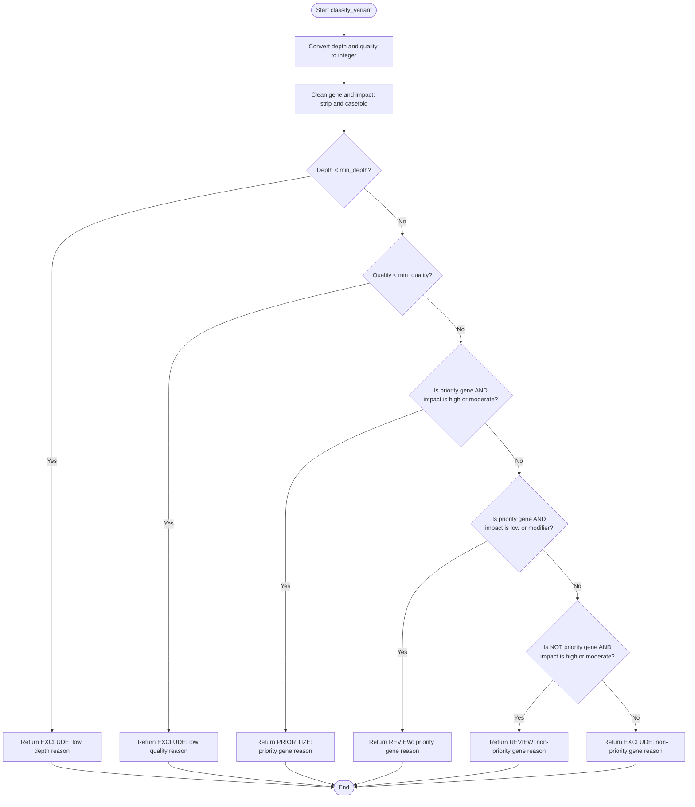

# Design - Variant Triage Service

Write this BEFORE you write the code, then keep it up to date. It is marked by the lecturer.
Use your own words, your own thresholds and your own data. Delete the guidance in italics.

Group ID: G01 Thresholds from data/params.json: min_depth = 10, min_quality = 75, top_k = 8

## 1. Decomposition

| Question | Our answer |
|---|---|
| Input | 1. A list of variant dictionaries (`rows`) loaded from `data/variants.csv`, where each dictionary holds string values for `variant`, `gene`, `chrom`, `pos`, `ref`, `alt`, `depth`, `quality`, and `impact`. 2. A configuration dictionary (`params`) loaded from `data/params.json` containing `min_depth` (int), `min_quality` (int), `priority_genes` (list of gene symbol strings), and `top_k` (int). |
| Output | 1. Classified variant records (`triage`) as a new list of new dictionaries containing all original fields plus `decision` and `reason` (without commas). 2. Summary dictionaries for `decision_counts`, `impact_counts` (excluding `exclude` variants), and alphabetical `gene_summary` (including `mean_depth` rounded to 1 decimal place). 3. A ranked list of top-k non-excluded variants (`rank_variants`). 4. Formatted CSV string (`results/triage.csv`) and plain-text summary report (`results/report.txt`). |
| Constraints | Variants are compared against `min_depth` and `min_quality`. Boundaries are **inclusive** (e.g., depth exactly 10 passes if min_depth is 10). Gene and impact values must have `strip()` and `casefold()` applied before comparison. |
| Rule order | The first rule that fires stops the process. Depth is checked before quality so a variant failing both reports depth. QC checks (Rules 1 & 2) run before gene/impact checks to ensure broken data is excluded immediately. |
| Out of scope | Real patient data, clinical advice, complex genomic annotations, insertions/deletions, and variant classification guidelines. |

## 2. Pseudocode or flowchart of classify_variant

    
## 3. Hand trace

*Trace the first six rows of YOUR data/variants.csv (v1 to v6) with YOUR thresholds, then two more rows of
your choice that reach rules 3 to 6. Do it by hand BEFORE you run your code, then compare with your code.*

| Variant | Gene | Depth | Quality | Impact | Rule that fires | Decision | Reason |
|---|---|---|---|---|---|---|---|
| V1 | MYC | 9 | 90 | moderate | Rule 1 | exclude | low depth: observed 9 is below 10 |
| V2 | MYC | 10 | 90 | low | Rule 6 | exclude | non-priority gene MYC with low impact |
| V3 | ATM | 11 | 90 | modifier | Rule 4 | review | priority gene ATM with modifier impact |
| V4 | APC | 30 | 79 | moderate | Rule 5 | review | non-priority gene APC with moderate impact |
| V5 | KRAS | 30 | 80 | moderate | Rule 5 | review | non-priority gene KRAS with moderate impact |
| V6 | MYC | 30 | 81 | modifier | Rule 6 | exclude | non-priority gene MYC with modifier impact |
| V7 | PTEN | 33 | 72 | low | Rule 2 | exclude | low quality: observed 72 is below 75 |
| V8 | ATM | 78 | 78 | moderate | Rule 3 | prioritize | priority gene ATM with moderate impact |

## 4. Test plan

Normal Cases:
-------------

Verify priority gene with high/moderate impact returns prioritize(Rule 3)
Priority gene with low/modifier returns review(Rule 4)
non-priority gene with high/moderate returns review(rule 5)
non-priority gene with low/modifier returns exclude(rule 6)

Boundary Cases(at group thresholds min_depth=10, min_quality=75):
------------------------------------------------------------------
Test depth=9 (rule1 exclude),depth=10 (passes depth QC),
depth=11(passes depth QC);test quality=74(Rule 2 exclude),
quality=75(passes quality QC), 
Quality=76(passes quality QC).

Rule precedence case:
---------------------
Test a priority gene variant with high impact where both depth=5 <10 and quality=50 < 75 to confirm rule 1(depth) fires first.

Immutability / pure function check: 
-----------------------------------
Confirm triage() and rank_variants() do not mutate the input list or inner dictionaries. 

Summary functions: 
-------------------
Verify decision_counts() and impact_counts() maintain exact key order including zero counts, and impact_counts() ignores exclude rows; verify gene_summary() sorts genes alphabetically and rounds mean_depth over all rows of a gene to 1 decimal place (returning {} on empty input).

Ranking & tie-breaking (rank_variants): 
---------------------------------------
Verify exclude variants are omitted, tie-breaking follows decision -> impact -> -quality -> -depth -> +pos, k=0 returns [], and k > len(candidates) returns all available candidates.

Awkward & invalid inputs:
--------------------------
 Test messy text (" brca1 ", " HIGH "), empty input lists [], and verify rank_variants(results, -1) raises ValueError using pytest.raises(ValueError).

## 5. Work plan

**Member 1 (Luqman):** Writes `results_to_csv` and `build_report`, handles Git integration, constants, and ruff checks.

**Member 2 (Rasyid):** Writes `classify_variant` and `triage` (Rules 1-6).

**Member 3 (Ainur):** Writes `decision_counts`, `impact_counts`, `gene_summary`, and `rank_variants`.

We will review each other's code by running the `main()` script together and doing a group pull request review before final submission. We will rotate the reviewer role.